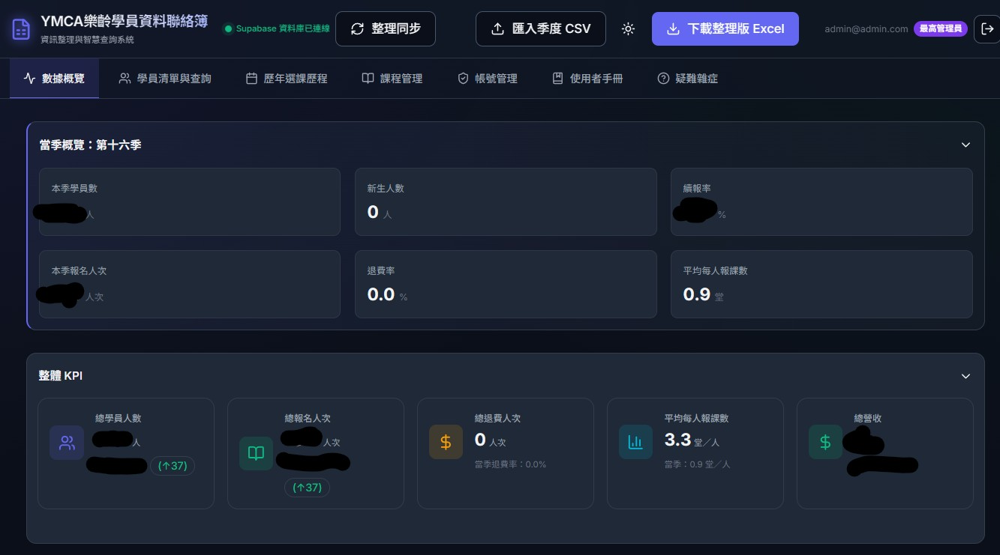
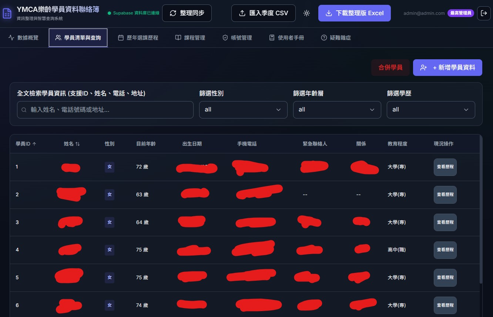
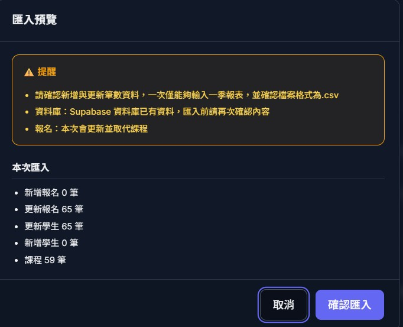
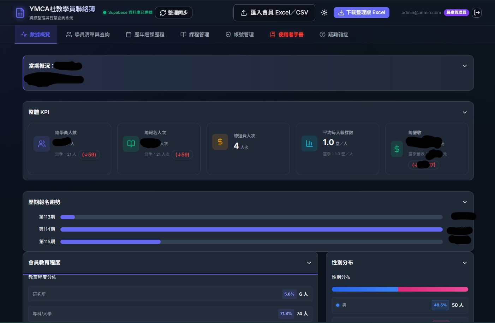
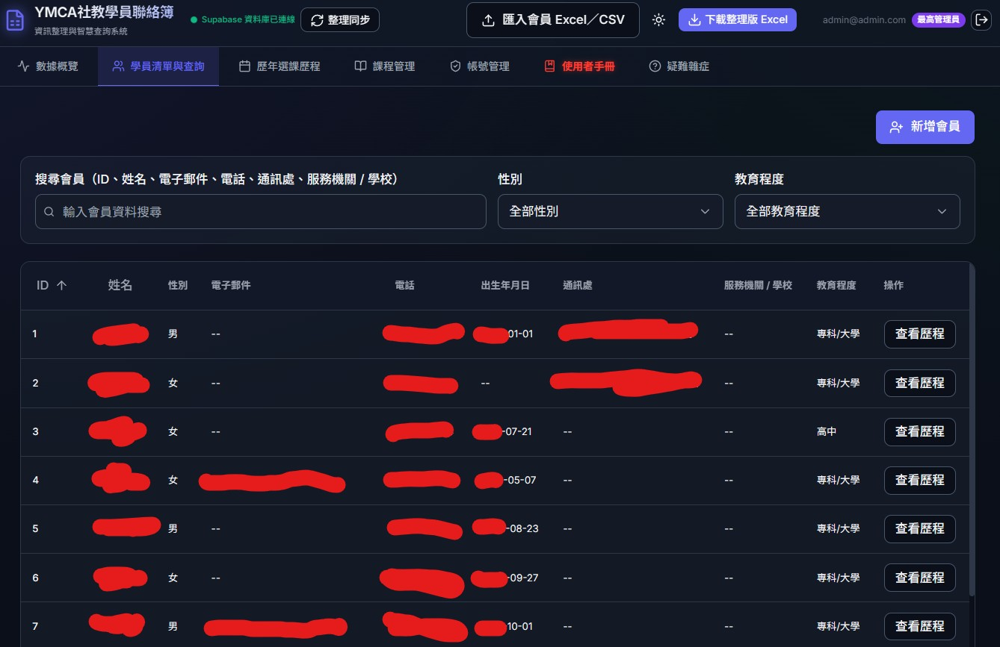
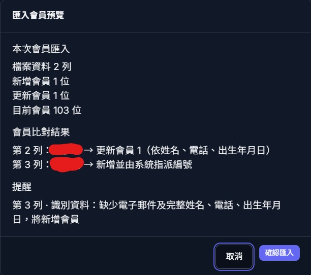

[**English**](./README.md) · [繁體中文](./README.zh-TW.md)

# Hi, I'm Tooru

I'm an Information Management student at **National Kaohsiung University of Science and Technology (NKUST)** who values hands-on implementation and problem-solving over theory alone. A lot of real-world organizational workflows are still stuck in paper forms and repetitive manual spreadsheets — my default move is to start from **user needs and actual workflows**, figure out where people are *actually* stuck, and build software that solves the problem in production.

When facing unfamiliar technical domains, I start from the problem's essence and underlying logic — researching, experimenting, and validating until I have a solid grasp, rather than staying inside a comfortable tech stack.

Off the clock, I'm a long-time **photographer**. Photography trained me to observe environments and understand people from an outsider's perspective. That lens carries straight into how I build software: I don't just ask *"does the feature work?"*, I also care about *"is the information presented clearly? Is the workflow intuitive? Can users with varying digital literacy actually finish their tasks in the real world?"*

> **Understand the problem → Analyze requirements → Design architecture → Collaborate with AI → Implement & verify → Maintain & improve**

---

## 🧰 Tech Stack

**Languages**

**Frontend & Backend**

**Tools**

**Past Experience & Hardware**

---

## 🚀 What I've Built

### Private work (production systems under data protection policies)

During my **2026 summer internship** at **Changhua YMCA** (via the Ching-Bao Foundation), I identified operational bottlenecks and solo-architected **two full-stack management systems** (`React`, `Supabase`, `PostgreSQL`) — both deployed to production and actively used by staff and senior learners.

- **`SeniorMember System`** — full-stack administrative platform (**6,800+ LOC, 240+ tests**) for student management, enrollment tracking, KPI dashboards, and batch Excel import/export. Digitized legacy paper-based workflows and improved data retrieval and archival efficiency by **~80%**. Built with a layered architecture across **19 DB migrations**, a custom multi-sheet Excel export engine, concurrent-safe CSV import (**composite-key identity matching + PostgreSQL Advisory Locks**), **three-tier RBAC with Row Level Security (RLS)**, and an **86% test-to-production code ratio**.
- **`SocialEducationMember System`** — extended the core architecture to a second center (Community Education) (**7,000+ LOC, 240+ tests**) with additional **billing workflows**, **enrollment audit triggers**, and **28+ DB migrations (6,200+ lines of SQL)**, demonstrating a reusable, multi-center architecture while maintaining the same concurrent-safe import and RLS security guarantees.

🖼️ <b>View YMCA System Screenshots</b> <i>(sensitive data redacted)</i>

 

#### SeniorMember System

| Dashboard (Overview & KPI) | Student List (Search & Filter) |
| :---: | :---: |
|  |  |
| Seasonal overview & KPI metrics | Full-text search & multi-dimensional filtering |

| CSV Import Validation |
| :---: |
|  |
| Batch validation with new/update statistics |

 

#### SocialEducationMember System

| Dashboard (Overview & Analytics) | Member List (Search & Management) |
| :---: | :---: |
|  |  |
| KPI, enrollment trends & demographic analysis | Member search & data management |

| Member Import Validation |
| :---: |
|  |
| Composite-key identity matching & validation |

### Public

- **[`PhotoSorter`](https://github.com/TWTooru/PhotoSorter)** — a practical file-automation utility built out of real photography workflow needs. Automatically organizes and sorts photo files using metadata to cut out repetitive manual file management.
- **[`Tower of Heroes`](https://github.com/NKUST-SAAD-16B/The-Tower-of-Heroes)** — game development project exploring gameplay programming, modular game systems design, and iterative software development.

---

## 💼 Work Experience

- **Changhua YMCA — System Development Intern** *(Summer 2026)*
  Via the Ching-Bao Foundation internship program. Led end-to-end requirements gathering, system architecture, database design, development, and deployment for two production management systems. Worked directly with staff and senior learners to iterate on UI/UX based on real-world feedback.
- **NKUST Public Relations Center — Student Worker**
  Managed high-volume campus news workflows and supported major university events (graduation ceremonies, anniversary celebrations). Handled high-pressure, real-time problem-solving (such as solo-coordinating seating changes for 100+ graduates during severe weather disruptions) and bridged communication across diverse departments — a habit that directly shapes how I gather user requirements before proposing technical solutions.

---

## 🤖 How I Collaborate With Claude Code / AI Agents

Below is the plugin and skill set I actually keep installed — also a reasonable starter list if you're putting together your own. **superpowers** drives my core day-to-day engineering loop; **supabase/agent-skills** backs my full-stack PostgreSQL and RLS work; **awesome-gamedev-agent-skills** has its own shelf whenever I'm building games.

### Third-Party Marketplaces & Skill Sets

| Plugin / Skill Set | Source |
| --- | --- |
| superpowers | <https://github.com/obra/superpowers> |
| supabase-agent-skills | <https://github.com/supabase/agent-skills> |
| awesome-gamedev-agent-skills | <https://github.com/gamedev-skills/awesome-gamedev-agent-skills> |
| vercel-skills (`find-skills`) | <https://github.com/vercel-labs/skills> |

### ⭐ Primary Workflow

- **[`superpowers`](https://github.com/obra/superpowers)** — structures every session into an explicit engineering loop rather than jumping straight to code generation: `brainstorming` (locking down problem boundaries and edge cases) → `writing-plans` (splitting architecture into small, verifiable steps) → `test-driven-development` / `subagent-driven-development` → `systematic-debugging` & `verification-before-completion` (a change isn't done until tests and verification commands actually pass).

### 🗄️ Backend, Database & Security

Pulled out whenever the work touches schemas, migrations, or data access rules:

- **[`supabase`](https://github.com/supabase/agent-skills)** · **`supabase-postgres-best-practices`** — PostgreSQL schema design, migration safety, Row Level Security (RLS) policy auditing, and query/concurrency optimization.

### 🎮 Game Development & Interactive Systems

- **[`awesome-gamedev-agent-skills`](https://github.com/gamedev-skills/awesome-gamedev-agent-skills)** — routed via `router` across engine-specific workflows (`Unity`, `Godot`) and cross-engine design disciplines (`game-ai`, `game-ui-ux`, `game-feel`, `save-systems`).

### 🔍 On-Demand Discovery

- **[`find-skills`](https://github.com/vercel-labs/skills)** — used to search and pull in domain-specific skills when stepping into an unfamiliar stack.

*Last reviewed: 2026-11-12.*

---

## 📫 Contact

- **GitHub**: [@TWTooru](https://github.com/TWTooru)
- **Email**: [qwe123rrcc@gmail.com](mailto:qwe123rrcc@gmail.com)
- **LinkedIn**: [Tain-You Lin](https://www.linkedin.com/in/tain-you-lin-8b845b380/)

---

## 📊 GitHub

