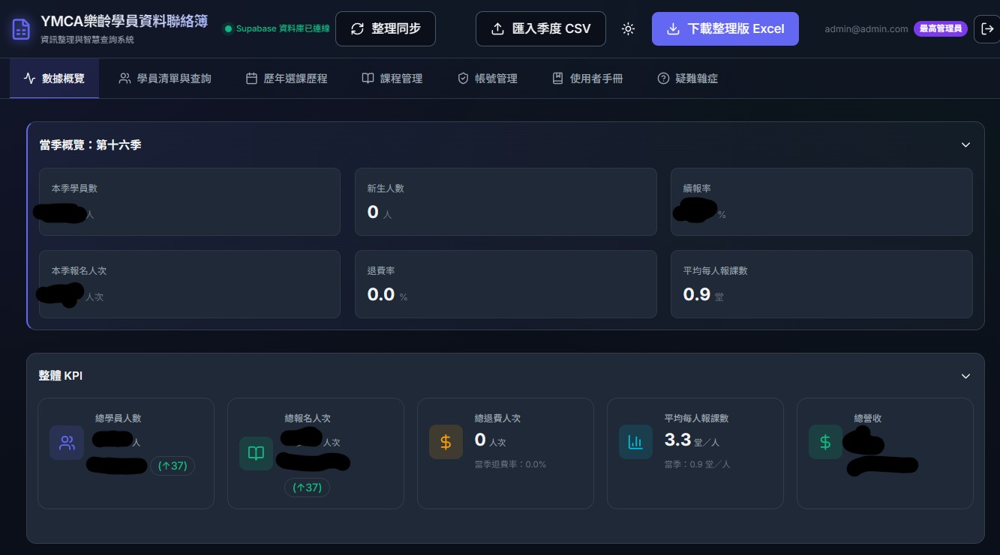
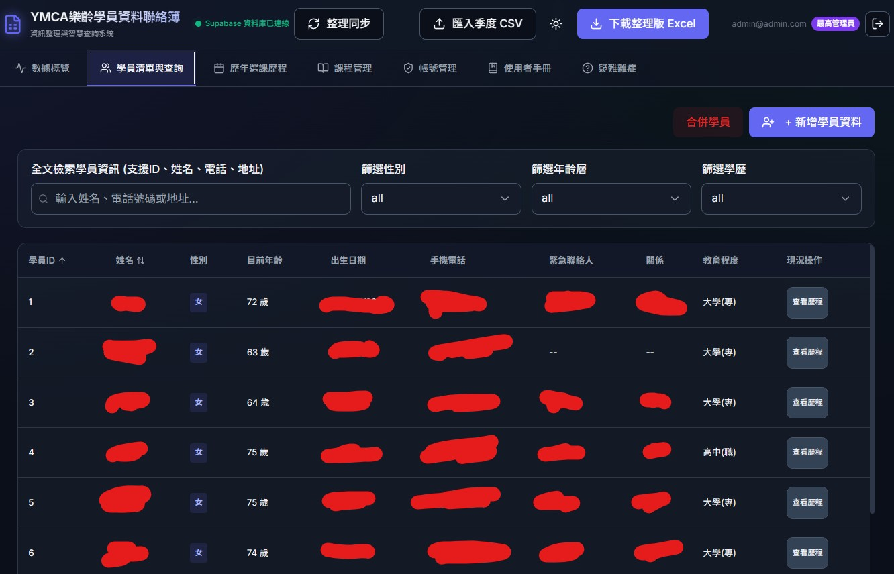
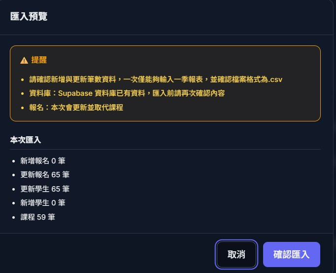
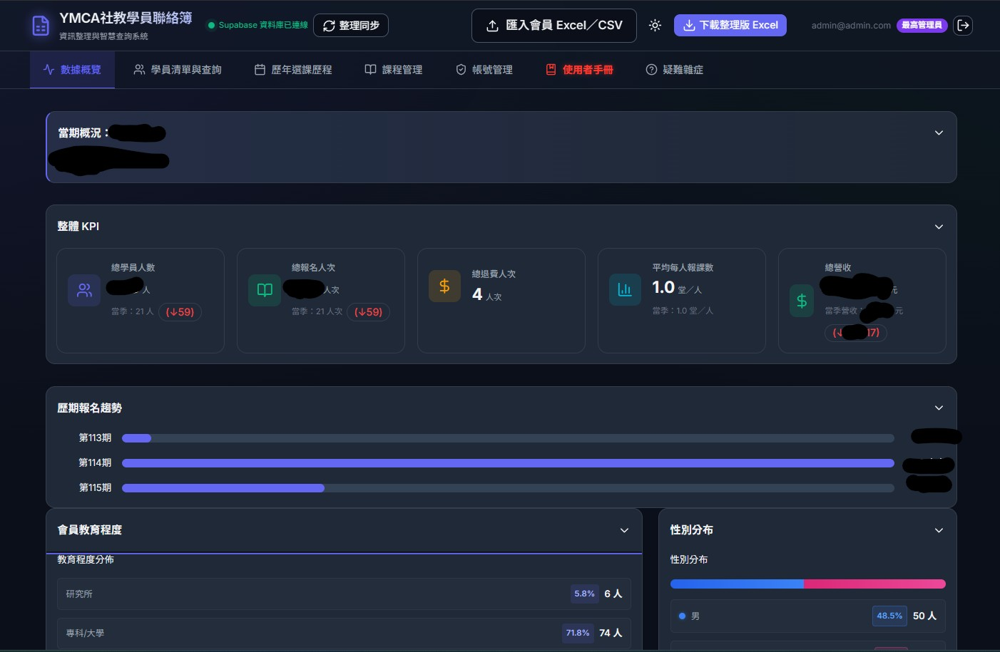
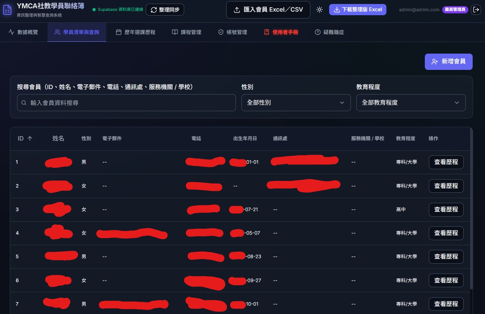
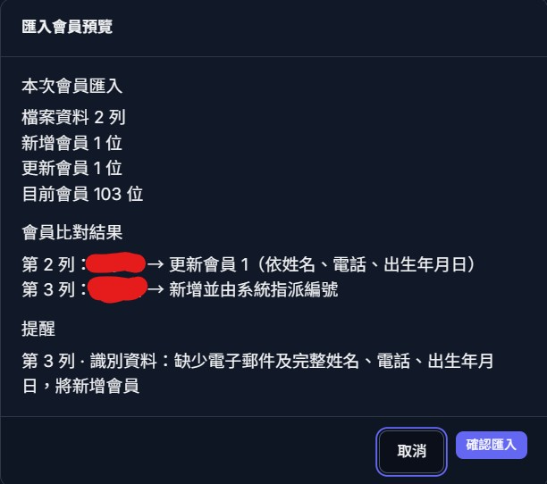

[English](./README.md) · [**繁體中文**](./README.zh-TW.md)

# Hi, 我是透流Tooru

我是就讀於**國立高雄科技大學（NKUST）資訊管理系**的學生，比起單純談論理論，我更重視實際動手實作與解決問題。許多組織與日常作業流程其實還停留在紙本表單與重複的人工整理——我的習慣是從**使用者需求與真實工作流**出發，把真正卡住的地方弄清楚，再透過持續測試與迭代，做出能實際上線解決問題的系統或工具。

面對不熟悉的技術領域時，我喜歡從問題的本質與底層邏輯切入，透過研究、實驗與驗證建立紮實的理解，而不是只停留在舒適圈內的技術棧。

在寫程式之外，我也長期投入**攝影**。攝影訓練了我以旁觀者的視角觀察環境與理解使用者的習慣，這也直接影響了我的開發思維——我不會只問「功能有沒有跑通？」，而是同時思考：「資訊呈現夠清楚嗎？操作流程直覺嗎？不同數位熟悉度的使用者在真實場景下能不能順利完成任務？」

> **理解問題 → 分析需求 → 設計架構 → 與 AI 協作 → 實作與驗證 → 維護與持續改進**

---

## 🧰 技術棧

**程式語言**

**前端與後端**

**開發工具**

**過往經驗與硬體整合**

---

## 🚀 做過的東西

### 私有專案（受專案隱私與資料保護規範限制）

在 **2026 年暑期實習**（透過慶寶勤勞基金會於**彰化 YMCA** 實習）期間，我主動盤點現場作業痛點，獨立規劃並開發了**兩套全端管理系統**（`React`、`Supabase`、`PostgreSQL`），目前皆已**正式上線投入日常營運**，將過去依賴紙本與人工核對的流程全面數位化，服務包含高齡學員與不同數位熟悉度的行政人員。

- **`SeniorMember System`（樂齡學員管理系統）** —— 獨立開發的全端管理後台（**6,800+ 行程式碼、240+ 項測試**），涵蓋學員管理、選課追蹤、KPI 儀表板與批次 Excel 匯入／匯出，將資料檢索與歸檔效率提升約 **80%**。採用分層架構與 **19 個資料庫 Migration**、客製化多工作表 Excel 匯出引擎、支援高併發安全的 CSV 匯入機制（**複合鍵身分比對 + PostgreSQL Advisory Locks**），並實作**三層式 RBAC 權限控管與 Row Level Security (RLS)**，測試與產品程式碼比例達 **86%**。
- **`SocialEducationMember System`（社教學員管理系統）** —— 將核心架構延伸至第二個業務中心（社會教育中心）（**7,000+ 行程式碼、240+ 項測試**），擴充了**收費與帳務工作流**、**選課異動稽核觸發器（Audit Triggers）** 與 **28+ 個資料庫 Migration（6,200+ 行 SQL）**，驗證了架構的可重用性與跨單位擴展能力。

🖼️ <b>查看 YMCA 系統畫面截圖</b> <i>（敏感資料皆已去識別化處理）</i>

 

#### SeniorMember System

| 儀表板（總覽與 KPI 指標） | 學員列表（搜尋與多維度篩選） |
| :---: | :---: |
|  |  |
| 學期總覽與核心指標統計 | 全文檢索與多條件篩選 |

| CSV 批次匯入驗證 |
| :---: |
|  |
| 批次資料驗證與新增／更新統計預覽 |

 

#### SocialEducationMember System

| 儀表板（總覽與數據分析） | 會員列表（搜尋與資料管理） |
| :---: | :---: |
|  |  |
| KPI、報名趨勢與人口統計分析 | 會員檢索與資料管理 |

| 會員匯入驗證 |
| :---: |
|  |
| 複合鍵身分比對與匯入前驗證 |

### 公開專案

- **[`PhotoSorter`](https://github.com/TWTooru/PhotoSorter)** —— 從自身攝影與檔案管理工作流痛點出發所開發的自動化工具。能依據照片 Metadata 自動分類與歸檔整理，大幅減少重複搬移與人工整理的時間。
- **[`Tower of Heroes`](https://github.com/NKUST-SAAD-16B/The-Tower-of-Heroes)** —— 遊戲開發專案，探索遊戲玩法程式設計、模組化系統實作，以及透過迭代開發解決複雜邏輯問題。

---

## 💼 工作與實習經歷

- **彰化 YMCA —— 系統開發實習生** *(2026 暑期)*
  透過慶寶勤勞基金會實習計畫參與。負責兩套正式環境學員管理系統的需求訪談、功能規劃、系統與資料庫架構設計、全端開發與測試部署；直接與現場行政人員及高齡學員溝通，根據真實使用回饋持續調整 UI/UX。
- **國立高雄科技大學 公關中心 —— 工讀生**
  負責處理大量校園新聞資訊並支援大型校級活動（畢業典禮、校慶等）。具備高壓環境下的即時應變能力（例如在天候突發狀況下，獨自協調並重排 100+ 位畢業生的座位動線），並習慣將複雜資訊轉譯給不同部門與受眾——這份溝通經驗也成為我在開發軟體前先釐清使用者真實痛點的基礎。

---

## 🤖 我如何和 Claude Code / AI Agents 共同協作

底下是我實際裝著在用的插件與 Skill 清單，也推薦給大家參考：
每個 session 的核心開發流程都由 **superpowers** 驅動；碰到全端資料庫與 RLS 權限時會叫出 **supabase/agent-skills**；做遊戲開發時則有專屬的 **awesome-gamedev-agent-skills** 工具箱。

### 第三方 Marketplace 與 Skill 套件

| 插件／Skill 套件 | 來源 |
| --- | --- |
| superpowers | <https://github.com/obra/superpowers> |
| supabase-agent-skills | <https://github.com/supabase/agent-skills> |
| awesome-gamedev-agent-skills | <https://github.com/gamedev-skills/awesome-gamedev-agent-skills> |
| vercel-skills (`find-skills`) | <https://github.com/vercel-labs/skills> |

### ⭐ 主力開發流

- **[`superpowers`](https://github.com/obra/superpowers)** —— 把每個 session 約束在明確的工程流程裡，而不是直接盲目產 code：`brainstorming`（動手前先釐清問題邊界與極端狀況）→ `writing-plans`（將架構拆解成可驗證的步驟）→ `test-driven-development`／`subagent-driven-development` → `systematic-debugging` 與 `verification-before-completion`（沒有實際跑過測試與驗證指令，就不算完成）。

### 🗄️ 後端、資料庫與資安控管

只要工作碰到資料表結構、Migration 或權限規則就出動：

- **[`supabase`](https://github.com/supabase/agent-skills)** · **`supabase-postgres-best-practices`** —— 負責 PostgreSQL Schema 設計、Migration 安全檢查、Row Level Security (RLS) 政策檢視，以及高併發與查詢效能最佳化。

### 🎮 遊戲開發與互動系統

- **[`awesome-gamedev-agent-skills`](https://github.com/gamedev-skills/awesome-gamedev-agent-skills)** —— 透過 `router` 調度特定遊戲引擎（`Unity`、`Godot`）與跨引擎系統設計規範（`game-ai`、`game-ui-ux`、`game-feel`、`save-systems`）。

### 🔍 隨選擴充

- **[`find-skills`](https://github.com/vercel-labs/skills)** —— 切入不熟悉的技術領域時，用來檢索並掛載對應領域的專用 Skill。

*最後檢視：2026-11-12。*

---

## 📫 聯絡方式

- **GitHub**: [@TWTooru](https://github.com/TWTooru)
- **Email**: [qwe123rrcc@gmail.com](mailto:qwe123rrcc@gmail.com)
- **LinkedIn**: [Tain-You Lin](https://www.linkedin.com/in/tain-you-lin-8b845b380/)

---

## 📊 GitHub

